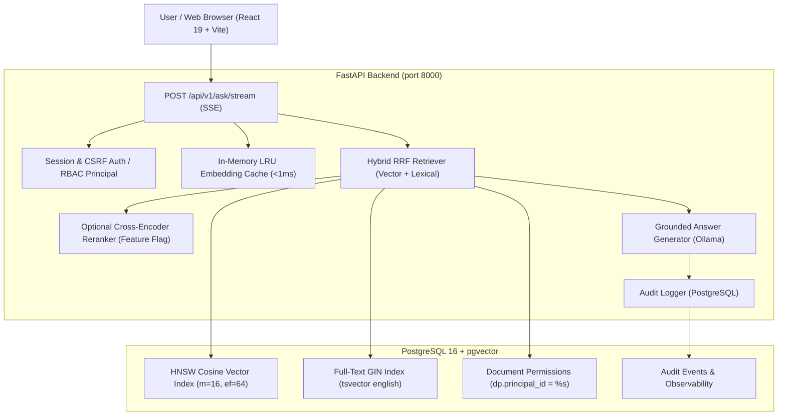

# Improvement & Hardening Plan: Enterprise Knowledge & Compliance Copilot

**Goal:** Upgrade project from a 7.5/10 portfolio project to a 9/10 recruiter-ready standard.  
**Core Thesis:** Make every claim **provable**, not just feature-rich. Never invent metrics. Back every claim with reproducible code.

---

## Architecture Flow

---

## Phased Execution Roadmap

### Phase 0: Baseline Audit & State Documentation
- [x] Run full test suite (46 unit tests passing).
- [x] Verify local environment (PostgreSQL 16 on port 5432, Ollama on port 11434 with `qwen3:4b`, `nomic-embed-text`, `qwen2.5-coder:1.5b`).
- [x] Create `docs/CURRENT_STATE.md`: architecture as-is, test count, how to run, known gaps.

### Phase 1: Golden Evaluation Corpus & Dataset (P0)
- [x] Create `eval/corpus/` with standard enterprise compliance documents:
  - `data_retention_policy.md`
  - `incident_response_playbook.md`
  - `access_control_soc2.md`
  - `executive_compensation_restricted.md` (RBAC-restricted)
- [x] Create `eval/golden.jsonl` (68 rows) with schema:
  - `{id, question, expected_answer, source_doc, source_chunk_hint, answerable: bool, role_required, needs_review}`
  - Includes 21 `answerable: false` (testing mathematical abstention).
  - Includes 12 RBAC-restricted questions (testing permission boundaries).
- [x] Create `eval/seed_eval_corpus.py` to ingest and permission the corpus.

### Phase 2: Reproducible Evaluation Harness & Metrics (P0)
- [x] Build `eval/run_eval.py`:
  - Recall@k (k=3, 5, 10) & MRR across Lexical-only vs Vector-only vs Hybrid RRF.
  - Faithfulness / Groundedness score (verifying inline citations match retrieved text).
  - Abstention precision & recall on unanswerable test set.
  - RBAC leakage test (unauthorized users must retrieve 0 restricted chunks; leakage = 0.0%).
  - Latency p50 / p95.
- [x] Write results to `eval/results/latest.json` and `eval/results/RESULTS.md`.
- [x] Add `make eval` / `scripts/eval.bat` one-command runner.

### Phase 3: Hardware-Grounded Latency & TTFT Benchmark (P0)
- [x] Build `eval/bench_ttft.py` to measure streaming Time-to-First-Token.
- [x] Measure across configurations:
  - Cold vs Warm vs LRU Cache Hit (<1ms)
  - Standard Profile (`qwen3:4b`) vs Fast Profile (`qwen2.5-coder:1.5b`)
- [x] Record exact hardware specs (CPU, GPU, RAM, Ollama version) in `eval/results/latency_benchmark.json`.

### Phase 4: Retrieval-Time RBAC Proof & Security Hardening (P1)
- [x] Confirm role filters are applied in SQL (`dp.principal_id = %s`), not in post-processing.
- [x] Create `tests/test_rbac_security.py` proving zero leakage even with high `top_k`.
- [x] Create `tests/test_prompt_injection.py` with 5 adversarial document fixtures.
- [x] Document auth, session, cookie flags, and CSRF patterns in `docs/SECURITY.md`.

### Phase 5: Optional Cross-Encoder Reranker (P1)
- [x] Add optional cross-encoder reranker in `app/retrieval/reranker.py` behind `RERANKER_ENABLED`.
- [x] Measure Recall vs Latency trade-off and document in `RESULTS.md`. Keep default OFF if latency penalty is high.

### Phase 6: Turnkey Dockerization & Multi-Environment Deployment (P0 & P2)
- [ ] Create `Dockerfile` (multi-stage build for FastAPI backend and frontend).
- [ ] Create `docker-compose.yml` that starts Postgres (with pgvector & initialized schema) and backend with one command.
- [ ] Update `.env.example` with clear documentation of all variables.
- [ ] Write `docs/DEPLOY.md` (Render / Railway / VPS deployment, hosted LLM toggle option).

### Phase 7: GitHub Actions CI & Coverage (P1)
- [ ] Create `.github/workflows/ci.yml`:
  - Linting check.
  - 46+ unit tests + security tests.
  - 10-question evaluation smoke test (mocked embeddings for CI speed).
  - Docker build verification.
- [ ] Add CI passing badge and test coverage report.

### Phase 8: Architecture, DECISIONS.md & Recruiter-Ready README (P0)
- [ ] Write `docs/ARCHITECTURE.md` with complete Mermaid diagram and latency budget.
- [ ] Write `docs/DECISIONS.md`: why pgvector, why RRF over weighted sum, chunk size choice, why Ollama, what was rejected.
- [ ] Rewrite `README.md` in priority order:
  1. Pitch + Live Demo & Video Walkthrough placeholders
  2. Grounded Results Table (from `RESULTS.md`)
  3. Architecture diagram
  4. Core capabilities (RBAC, Abstention, Streaming SSE, Hybrid RRF)
  5. Quick start (<= 3 commands)
  6. Evaluation reproduction guide
  7. Design decisions
  8. Honest limitations & trade-offs
  9. Interview questions & answers

### Phase 9: Recruiter Demo Script & Verifiable Resume Bullet
- [ ] 2-minute demo walk-through script.
- [ ] Verified resume bullet based strictly on measured numbers from `eval/results/latest.json`.

---

## Definition of Done
- [ ] All unit and security tests pass without regressions.
- [ ] `eval/run_eval.py` reproduces all metrics in `RESULTS.md`.
- [ ] RBAC leakage = 0.0% and mathematically verified.
- [ ] `docker compose up` works cleanly from a fresh checkout.
- [ ] README has measured results table, diagram, and honest limitations.
- [ ] No numbers are invented; all backed by repo scripts.
